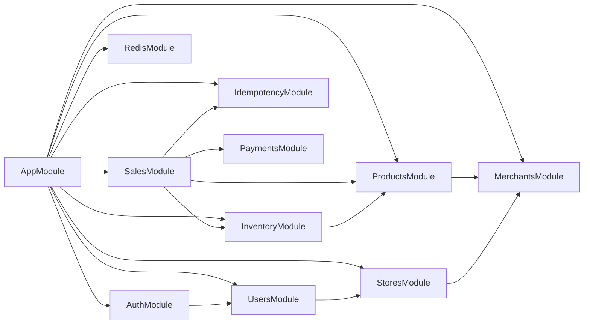
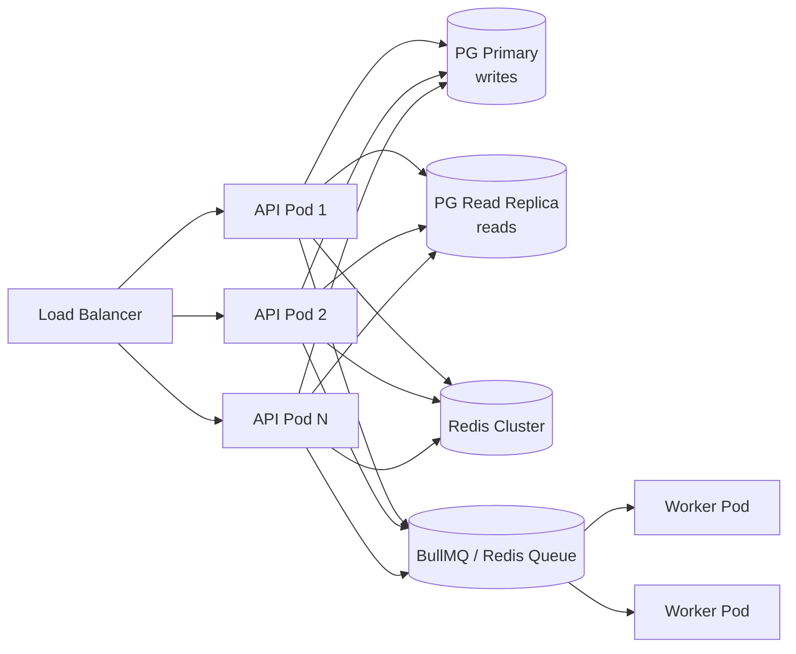

# 01 — Architecture

## 1. Problem Summary

A multi-tenant POS backend where each **Merchant** owns one or more **Stores**. Store users (cashiers, managers, admins) authenticate via JWT and interact with that store's products, inventory, and sales. A mock payment provider processes payments. Redis caches read-heavy product/inventory lookups.

---

## 2. High-Level Architecture Diagram

```mermaid
graph TD
    subgraph Clients
        POS[POS Terminal / Client]
        ADMIN[Admin Dashboard]
    end

    subgraph API["NestJS API (Stateless, Horizontally Scalable)"]
        GW[HTTP Gateway<br>Rate Limiter · CORS · Helmet]
        AUTH[Auth Module<br>JWT Guard · RBAC Guard]
        MODS[Feature Modules<br>Merchants · Stores · Users<br>Products · Inventory · Sales<br>Payments · Idempotency]
        IDEM[Idempotency Interceptor]
        EXF[Global Exception Filter]
        LOG[Logging Interceptor]
    end

    subgraph Storage
        PG[(PostgreSQL<br>Primary)]
        PGR[(PostgreSQL<br>Read Replica ①)]
        RD[(Redis)]
    end

    subgraph External
        MOCK[Mock Payment Provider<br>PaymentPort interface]
    end

    POS -->|HTTPS REST| GW
    ADMIN -->|HTTPS REST| GW
    GW --> AUTH
    AUTH --> MODS
    MODS --> IDEM
    MODS --> EXF
    MODS --> LOG
    MODS -->|writes / transactions| PG
    MODS -->|reads ①| PGR
    MODS -->|cache get/set/invalidate| RD
    MODS -->|PaymentPort.charge()| MOCK

    style API fill:#f0f4ff,stroke:#4a6cf7
    style Storage fill:#f0fff4,stroke:#22c55e
    style External fill:#fff7ed,stroke:#f97316
```

---

## 3. NestJS Modular Monolith Structure

```
pos-api/
├── src/
│   ├── main.ts                        # Bootstrap, Swagger, global pipes/filters
│   ├── app.module.ts                  # Root module
│   │
│   ├── config/                        # ConfigModule, env validation (Joi/zod)
│   │   └── configuration.ts
│   │
│   ├── common/                        # Cross-cutting concerns
│   │   ├── decorators/                # @CurrentUser, @StoreId, @Roles, @IdempotencyKey
│   │   ├── filters/                   # GlobalExceptionFilter
│   │   ├── guards/                    # JwtAuthGuard, RolesGuard, StoreAccessGuard
│   │   ├── interceptors/              # LoggingInterceptor, IdempotencyInterceptor
│   │   ├── pipes/                     # ValidationPipe (global)
│   │   └── types/                     # JwtPayload, RequestUser, ApiError
│   │
│   ├── database/                      # TypeORM DataSource, migrations, seeds
│   │   ├── data-source.ts
│   │   ├── migrations/
│   │   └── seeds/
│   │
│   ├── modules/
│   │   ├── auth/                      # POST /auth/login, /auth/refresh
│   │   │   ├── auth.controller.ts
│   │   │   ├── auth.service.ts
│   │   │   ├── strategies/jwt.strategy.ts
│   │   │   └── dto/
│   │   │
│   │   ├── merchants/                 # Merchant CRUD (OWNER only)
│   │   │   ├── merchant.controller.ts
│   │   │   ├── merchant.service.ts
│   │   │   ├── merchant.repository.ts
│   │   │   └── entities/merchant.entity.ts
│   │   │
│   │   ├── stores/                    # Store CRUD (OWNER/ADMIN)
│   │   │   └── ...
│   │   │
│   │   ├── users/                     # User management within tenant
│   │   │   └── ...
│   │   │
│   │   ├── products/                  # Product catalog (merchant-scoped)
│   │   │   └── ...
│   │   │
│   │   ├── inventory/                 # Store-level stock
│   │   │   └── ...
│   │   │
│   │   ├── sales/                     # Create sale, list sales, get sale
│   │   │   ├── sales.controller.ts
│   │   │   ├── sales.service.ts
│   │   │   ├── sales.repository.ts
│   │   │   └── entities/
│   │   │       ├── sale.entity.ts
│   │   │       └── sale-item.entity.ts
│   │   │
│   │   ├── payments/                  # Payment abstraction + mock provider
│   │   │   ├── payment.port.ts        # Interface (PaymentPort)
│   │   │   ├── mock-payment.provider.ts
│   │   │   └── payments.module.ts
│   │   │
│   │   └── idempotency/               # Idempotency-Key storage & lookup
│   │       ├── idempotency.service.ts
│   │       └── entities/idempotency-key.entity.ts
│   │
│   └── redis/                         # Redis module (ioredis / cache-manager)
│       └── redis.module.ts
│
├── test/                              # e2e tests
├── docker-compose.yml
├── .env.example
├── package.json
└── README.md
```

---

## 4. Module Dependency Graph



---

## 5. Cross-Cutting Concerns

| Concern | Mechanism | Applied At |
|---|---|---|
| Authentication | `JwtAuthGuard` (Passport JWT strategy) | All routes (global default) |
| Authorization / RBAC | `RolesGuard` + `@Roles()` decorator | Per controller/route |
| Tenant isolation | `StoreAccessGuard` + repository scoping | Guard + every repository query |
| Idempotency | `IdempotencyInterceptor` on POST /sales | Interceptor (pre-handler + post-handler) |
| Validation | Global `ValidationPipe` (class-validator) | All DTOs |
| Error format | `GlobalExceptionFilter` | All exceptions |
| Logging | `LoggingInterceptor` | All requests/responses |
| Config | `ConfigModule.forRoot()` with Joi schema | App bootstrap |

---

## 6. ORM Decision

**Chosen: TypeORM**

| Option | Pros | Cons | Decision |
|---|---|---|---|
| **TypeORM** | NestJS first-class support, decorators, migrations CLI, EntityManager for transactions | Can hide N+1, less explicit than raw SQL | ✅ Chosen |
| Prisma | Great DX, type-safe client | Separate migration tool, schema.prisma diverges from module pattern | Rejected |
| Knex/kysely | Explicit SQL control | Too low-level for time budget, no entity model | Rejected |
| MikroORM | Excellent Unit-of-Work | Less community, steeper learning curve | Rejected |

TypeORM's `EntityManager` (or `DataSource.transaction()`) makes multi-step atomic operations straightforward and maps directly to the NestJS provider injection pattern.

---

## 7. Scaling Path (Documented, Not Implemented)



| Scaling Lever | Strategy |
|---|---|
| Stateless API | JWT-based auth, no server-side session |
| Horizontal API scaling | Multiple pods behind load balancer |
| DB reads | Read replica for list/report queries |
| DB writes | Connection pooling via PgBouncer |
| Hot data | Redis cache (product catalog, inventory snapshots) |
| Heavy background jobs | BullMQ workers (receipt emails, reports) |
| Large tables | Table partitioning by `merchant_id` or date range on `sales` |
| Rate limiting | Redis-backed sliding window per store/user |

> **Implemented now**: stateless JWT, Redis cache (product catalog), connection pooling via TypeORM pool config, global exception filter, structured logging. Everything else is the documented future path.
