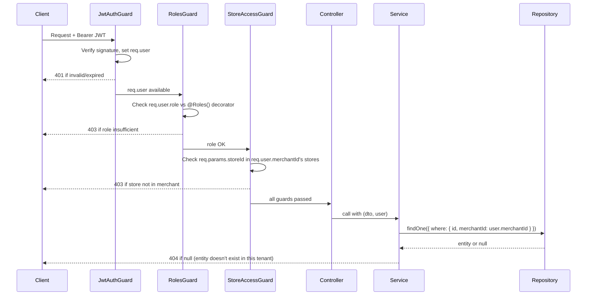

# 03 — Tenant Isolation

## 1. Core Principle

**Tenant context is derived exclusively from the verified JWT — never from request body, path parameters, or query strings.**

The JWT is signed by the server's private secret. When it arrives, the `JwtStrategy` decodes it and populates `req.user` with:

```typescript
interface JwtPayload {
  sub: string;          // user.id
  merchantId: string;   // user.merchant_id
  storeId: string | null; // user.store_id (null for OWNER/ADMIN)
  role: UserRole;       // OWNER | ADMIN | MANAGER | CASHIER
  iat: number;
  exp: number;
}
```

An attacker who changes `/stores/:storeId` in the URL path can never reach another tenant's data because every repository query **AND** the `StoreAccessGuard` enforce `merchant_id` from the token — not from the URL.

---

## 2. Enforcement Layers (Defence in Depth)



### Layer 1 — JwtAuthGuard (global)
Applied globally via `APP_GUARD`. Every route requires a valid JWT unless decorated with `@Public()`.

### Layer 2 — RolesGuard (global)
Checks `req.user.role` against the `@Roles(...)` metadata. Applied globally, no-ops when no `@Roles()` metadata present.

### Layer 3 — StoreAccessGuard (route-specific)
For routes that operate on a specific store (`/stores/:storeId/...`), this guard:
1. Reads `:storeId` from `req.params`
2. Verifies the store belongs to `req.user.merchantId` via a DB query (cached in Redis for performance)
3. Returns **403** if the store exists but is in a different merchant
4. Returns **404** if the store does not exist at all (no information leak)

### Layer 4 — Repository-Level Scoping
Every repository method that reads/writes a resource always includes the tenant filter:

```typescript
// ✅ Always scope by merchantId / storeId from JWT — never trust external input
async findProduct(id: string, merchantId: string): Promise<Product> {
  const product = await this.repo.findOne({
    where: { id, merchantId, deletedAt: IsNull() },
  });
  if (!product) throw new NotFoundException(`Product not found`);
  return product;
}
```

Even if a guard is mistakenly skipped, the repository will still return nothing for a cross-tenant ID.

---

## 3. 404 vs 403 Policy

| Scenario | HTTP Status | Reason |
|---|---|---|
| Store ID does not exist at all | **404** | The resource genuinely does not exist |
| Store exists but belongs to another merchant | **403** | The resource exists but caller has no access — using 404 here leaks existence info, but we choose 403 to be explicit about access denial (security through clarity > security through obscurity for an API) |
| Product/sale in a different tenant's store | **404** | We never confirm the object exists; the scoped query returns null, which is a genuine "not found" within the caller's tenant namespace |

> **Rationale**: Returning 404 for cross-tenant objects (at the repository layer) is the safer default because it does not confirm whether the ID exists globally. The `StoreAccessGuard` (which runs before business logic) is the place to return 403 with clarity, since by that point we've already verified the store exists but isn't in the caller's merchant.

---

## 4. RBAC Matrix

Roles hierarchy: `OWNER > ADMIN > MANAGER > CASHIER`

| Endpoint | OWNER | ADMIN | MANAGER | CASHIER |
|---|---|---|---|---|
| `POST /auth/login` | ✅ | ✅ | ✅ | ✅ |
| `GET /merchants/:id` | ✅ | ✅ | ❌ | ❌ |
| `PATCH /merchants/:id` | ✅ | ❌ | ❌ | ❌ |
| `POST /stores` | ✅ | ✅ | ❌ | ❌ |
| `GET /stores` | ✅ | ✅ | ✅ | ❌ |
| `GET /stores/:id` | ✅ | ✅ | ✅ (own store) | ❌ |
| `POST /users` | ✅ | ✅ | ❌ | ❌ |
| `GET /users` | ✅ | ✅ | ✅ (own store) | ❌ |
| `POST /products` | ✅ | ✅ | ❌ | ❌ |
| `GET /products` | ✅ | ✅ | ✅ | ✅ |
| `PATCH /products/:id` | ✅ | ✅ | ❌ | ❌ |
| `GET /inventory` | ✅ | ✅ | ✅ | ✅ |
| `PUT /inventory/:productId` | ✅ | ✅ | ✅ | ❌ |
| `POST /sales` | ✅ | ✅ | ✅ | ✅ |
| `GET /sales` | ✅ | ✅ | ✅ | ✅ (own only) |
| `GET /sales/:id` | ✅ | ✅ | ✅ | ✅ (own only) |

> **Note**: OWNER and ADMIN are merchant-level (no `store_id` in JWT). MANAGER and CASHIER are always scoped to a single store via `store_id` in JWT.

---

## 5. Implementation Notes

- `@CurrentUser()` custom decorator extracts `req.user` (the decoded JWT payload) cleanly from any controller parameter.
- `@StoreId()` custom decorator extracts `req.user.storeId ?? req.params.storeId` depending on the role, so service methods receive a consistent store ID.
- Services never accept `merchantId` or `storeId` as raw DTO fields — they always come from the injected `JwtPayload`.
- The `StoreAccessGuard` result is cached in Redis for 60 seconds (store metadata changes rarely) to avoid a DB lookup on every request.
