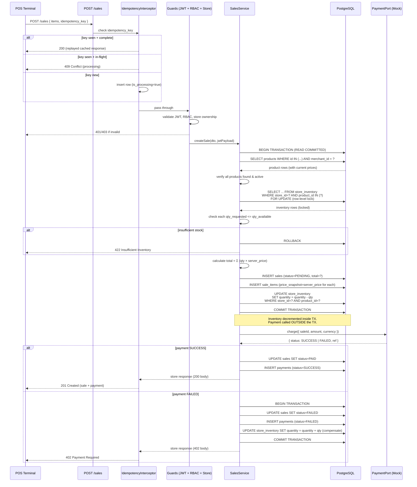
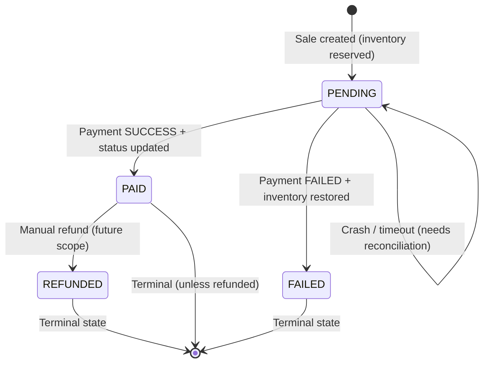

# 04 — Sale Flow and Transactions

## 1. Create Sale — Sequence Diagram



---

## 2. Payment vs DB Transaction: The Critical Decision

### The Problem
The payment call is to an external mock provider. In a real system it would be an HTTP call that can take 2–30 seconds. Holding a PostgreSQL transaction open for that duration would:
- Hold row locks on inventory rows (blocking other POS terminals)
- Exhaust the DB connection pool
- Turn a slow payment provider into an API-wide bottleneck

### Options Considered

| Approach | Description | Problem |
|---|---|---|
| **A — Payment inside TX** | Open TX → decrement inventory → call payment → commit | Holds locks during I/O; terrible under load |
| **B — Payment before TX** (optimistic) | Charge first → open TX → decrement inventory | Double charge risk on crash between payment and TX commit |
| **C — Payment outside TX (chosen)** | Open TX → decrement inventory → commit → call payment → compensate on failure | Short lock time; compensation handles failure |
| **D — Saga / outbox** | Event-driven, eventual consistency | Overkill for this scope; adds significant complexity |

### ✅ Chosen: Option C — Decrement First, Then Pay, Compensate on Failure

**Why**:
1. The DB transaction is short (only inventory check + decrement + sale insert — no I/O).
2. If payment fails, a **compensation transaction** re-increments inventory and marks the sale FAILED.
3. Crash between payment success and the status update? The sale stays PENDING — a background reconciliation job (future scope) or a re-query to the payment provider by idempotency-key would resolve it.
4. Risk of "ghost decrement" (inventory decremented, payment never completed, no compensation) is addressed by idempotency: a retry will hit the stored 402 response and not re-process.

### Failure Handling Table

| Failure Point | State | Recovery |
|---|---|---|
| DB TX fails during validation | Nothing committed | Transaction rolled back; 422 returned |
| DB TX fails after inventory decrement (pre-commit) | Nothing committed | Auto-rollback; 500 returned; safe to retry with same idempotency key |
| Payment returns FAILED | Sale PENDING, inventory decremented | Compensation TX: increment inventory + set sale FAILED + create payment record |
| Payment returns SUCCESS, status update fails | Sale PENDING but actually paid | Idempotency key stored with 201 body before crash risk; future reconciliation |
| Crash between payment.SUCCESS and status update | Sale stays PENDING | Idempotency key not finalized → retry re-fetches from payment provider (future) or manual reconciliation |
| Duplicate request (idempotency replay) | Already stored response | Return cached 201/402 without re-executing |
| Insufficient stock | No sale/payment created | TX rolled back; 422 returned |

---

## 3. Sale / Payment State Machine



**Payment record** mirrors sale status:

```
sale.status=PENDING  ↔  payment.status=PENDING
sale.status=PAID     ↔  payment.status=SUCCESS
sale.status=FAILED   ↔  payment.status=FAILED
```

---

## 4. Transaction Isolation Level

We use **READ COMMITTED** (PostgreSQL default) for the main sale transaction. This is sufficient because:
- We use `SELECT ... FOR UPDATE` to lock inventory rows, preventing concurrent reads of stale stock.
- REPEATABLE READ would not add protection beyond what `FOR UPDATE` already provides.
- SERIALIZABLE adds overhead; we handle concurrency with explicit locking (see `05-concurrency-strategy.md`).
