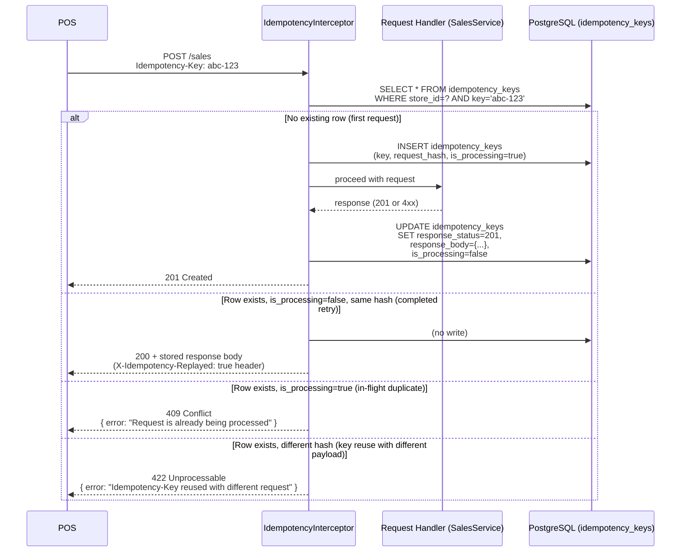

# 06 — Idempotency Strategy

## 1. Problem

POS terminals operate in unreliable network environments. A cashier presses "Submit Payment" and the network drops. The terminal retries. Without idempotency, the same sale is created twice — double-charging the customer and double-decrementing inventory.

---

## 2. Idempotency-Key Design

### Header
```
Idempotency-Key: <client-generated UUID or nanoid>
```
Clients send this header on every `POST /sales` request. The server uses it to detect and deduplicate retries.

### Key Scope
Keys are scoped to `(store_id, key)` — a key from Store A cannot conflict with the same string used in Store B. This matches multi-tenant isolation.

### Request Hash
Along with the key, we store `SHA-256(method + path + sorted_body_json)` as `request_hash`. If the same key arrives with a **different payload** (a genuine programming error, not a retry), we return **409 Conflict** rather than silently processing a different request.

### Stored Response
After a request completes, we store `(response_status, response_body)` in the `idempotency_keys` table. On a retry, we return the exact stored response without re-executing the business logic.

---

## 3. Sequence Diagram



---

## 4. In-Flight Duplicate Handling

The `is_processing` flag (a boolean column with default `false`) acts as an advisory lock:

1. **First request**: `INSERT ... is_processing=true` — succeeds because no row exists yet.
2. **Concurrent duplicate**: `INSERT` fails with UNIQUE constraint → query returns existing row with `is_processing=true` → return **409 Conflict**.
3. **After completion**: `UPDATE ... is_processing=false, response_status=201, response_body={...}`.
4. **Retry after completion**: Finds `is_processing=false` with stored response → return **200 replayed**.

The UNIQUE constraint on `(store_id, key)` is the database-level guarantee that only one row can be in-flight for a given key.

---

## 5. HTTP Status Codes

| Scenario | Status | Notes |
|---|---|---|
| First request, success | 201 Created | Normal |
| First request, payment failed | 402 Payment Required | Stored for replay |
| First request, insufficient stock | 422 Unprocessable | Stored for replay |
| Retry (completed, same payload) | 200 OK | Body is stored response, `X-Idempotency-Replayed: true` header |
| In-flight duplicate | 409 Conflict | Ask POS to wait and retry after delay |
| Same key, different payload | 422 Unprocessable | Client bug — cannot reuse a key with different data |

> **Why 200 for replay, not the original status?** RFC 9110 and Stripe's idempotency spec return the original status for replays. We follow that convention — `X-Idempotency-Replayed: true` header signals it's a replay.

---

## 6. Expiry / TTL

- Keys expire after **24 hours** (`expires_at = created_at + INTERVAL '24 hours'`).
- A background cleanup cron (or a simple DB job) deletes expired rows:
  ```sql
  DELETE FROM idempotency_keys WHERE expires_at < now();
  ```
- For the assignment scope, a NestJS `@Cron('0 2 * * *')` task handles this nightly.
- 24 hours covers all realistic POS retry windows (network timeouts are seconds to minutes).

---

## 7. Which Endpoints Are Idempotency-Protected?

| Endpoint | Idempotency Protected | Reason |
|---|---|---|
| `POST /sales` | ✅ Yes | Critical — creates sale, charges payment, decrements inventory |
| `POST /auth/login` | ❌ No | Naturally idempotent (returns token); no side-effect to protect |
| `POST /products` | ❌ No | Low risk; duplicate is visible in product list |
| `PUT /inventory` | ❌ No | PUT is idempotent by HTTP semantics |
| `PATCH /sales/:id/refund` | ✅ Future | Would protect refund from double-execution |

---

## 8. Why Not Redis for Idempotency?

| Option | Pros | Cons |
|---|---|---|
| **PostgreSQL table (chosen)** | Transactional — key insert and sale commit are in the same DB | Slightly more storage |
| Redis | Fast lookup | Not transactional with the main DB; risk of redis flush losing idempotency data; adds operational dependency |

Since idempotency is critical for financial correctness, we store it in the same PostgreSQL instance. Redis is used separately for performance caching.
