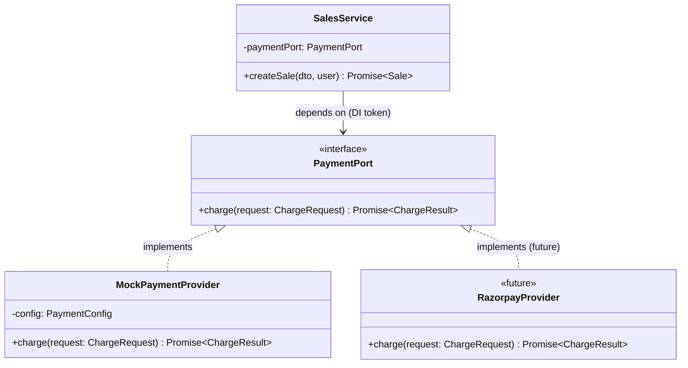

# 07 — Payment Abstraction

## 1. Design Goal

The sale flow must be agnostic to *how* a payment is processed. Today it's a mock; tomorrow it could be Razorpay, Stripe, or PayU. Swapping providers must require zero changes to `SalesService`.

---

## 2. Pattern: Port / Adapter (Strategy)



---

## 3. Interface Definition

```typescript
// src/modules/payments/payment.port.ts

export interface ChargeRequest {
  saleId: string;
  amountMinorUnits: number;   // e.g. 1299 for ₹12.99
  currency: string;            // ISO 4217, e.g. 'INR'
  description?: string;
  metadata?: Record<string, unknown>;
}

export interface ChargeResult {
  status: 'SUCCESS' | 'FAILED';
  providerReference: string;   // external transaction ID
  rawResponse: Record<string, unknown>;
  failureReason?: string;
}

export const PAYMENT_PORT = Symbol('PAYMENT_PORT');

export interface PaymentPort {
  charge(request: ChargeRequest): Promise<ChargeResult>;
}
```

---

## 4. Mock Provider Implementation

```typescript
// src/modules/payments/mock-payment.provider.ts

@Injectable()
export class MockPaymentProvider implements PaymentPort {
  constructor(private readonly config: ConfigService) {}

  async charge(request: ChargeRequest): Promise<ChargeResult> {
    // Simulate network latency (realistic for tests)
    await sleep(this.config.get('MOCK_PAYMENT_DELAY_MS', 50));

    // Deterministic control:
    //   metadata.simulateFailure=true  → always fail
    //   env MOCK_PAYMENT_FAIL_RATE=0.0 → always succeed (default for tests)
    //   env MOCK_PAYMENT_FAIL_RATE=1.0 → always fail
    const forceFailure = request.metadata?.simulateFailure === true;
    const failRate = parseFloat(this.config.get('MOCK_PAYMENT_FAIL_RATE', '0'));
    const shouldFail = forceFailure || Math.random() < failRate;

    if (shouldFail) {
      return {
        status: 'FAILED',
        providerReference: `mock_fail_${Date.now()}`,
        rawResponse: { error: 'Payment declined by mock provider' },
        failureReason: 'INSUFFICIENT_FUNDS',
      };
    }

    return {
      status: 'SUCCESS',
      providerReference: `mock_txn_${Date.now()}_${request.saleId.slice(0, 8)}`,
      rawResponse: { authorized: true, gateway: 'mock' },
    };
  }
}
```

---

## 5. Dependency Injection Wiring

```typescript
// src/modules/payments/payments.module.ts

@Module({
  providers: [
    {
      provide: PAYMENT_PORT,
      useClass: MockPaymentProvider,  // swap here for real provider
    },
    MockPaymentProvider,
  ],
  exports: [PAYMENT_PORT],
})
export class PaymentsModule {}
```

```typescript
// src/modules/sales/sales.service.ts

@Injectable()
export class SalesService {
  constructor(
    @Inject(PAYMENT_PORT) private readonly paymentPort: PaymentPort,
    // ... other repos
  ) {}

  async createSale(dto: CreateSaleDto, user: JwtPayload): Promise<Sale> {
    // ...
    const result = await this.paymentPort.charge({
      saleId: sale.id,
      amountMinorUnits: sale.totalMinorUnits,
      currency: sale.currency,
      metadata: dto.paymentMetadata, // allows simulateFailure flag from tests
    });
    // ...
  }
}
```

---

## 6. Simulating SUCCESS and FAILED in Tests

Tests control payment outcome via `metadata.simulateFailure`:

```typescript
// Successful sale test:
const saleDto = {
  items: [...],
  paymentMetadata: {},  // no flag → SUCCESS
};

// Failed sale test:
const saleDto = {
  items: [...],
  paymentMetadata: { simulateFailure: true },
};
```

For integration tests, `MOCK_PAYMENT_FAIL_RATE=0` ensures deterministic SUCCESS unless `simulateFailure` is set. This makes tests reliable without mocking the payment port itself.

---

## 7. Future Provider Swap

To add a real provider (e.g., Razorpay):
1. Create `RazorpayProvider implements PaymentPort` in `payments/providers/`
2. Change `useClass: MockPaymentProvider` to `useClass: RazorpayProvider` in `payments.module.ts`
3. Zero changes to `SalesService` or any other module

The `PAYMENT_PORT` DI token is the seam that decouples them.
