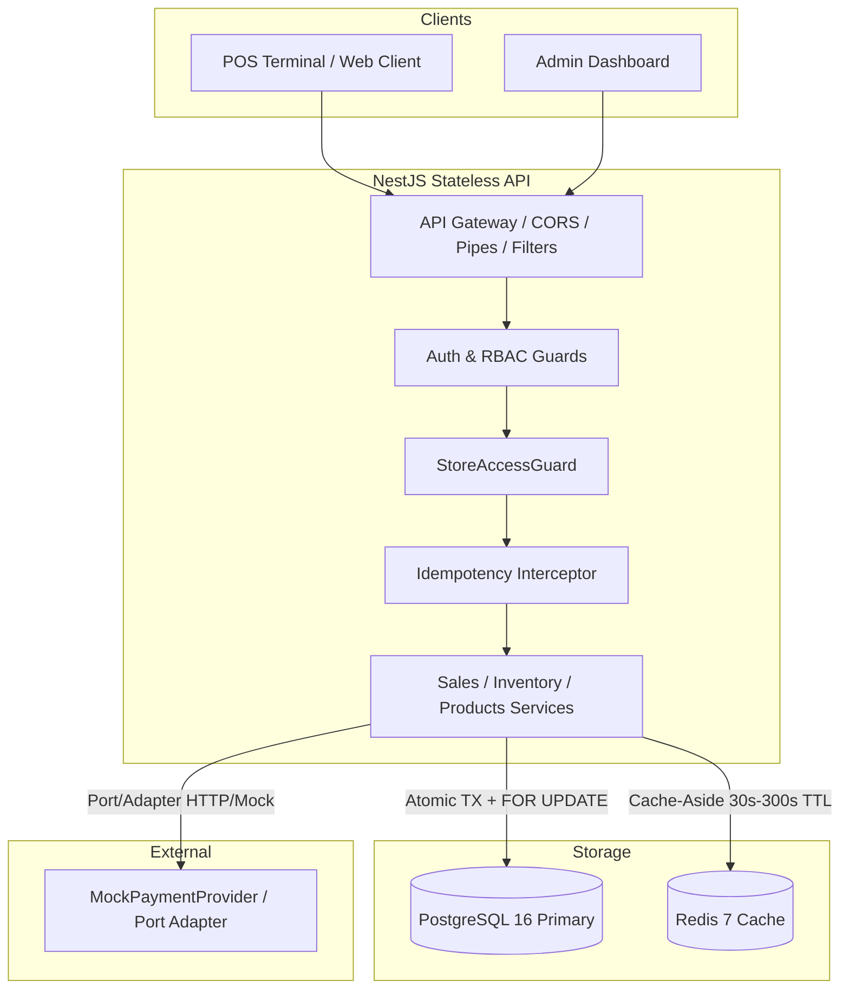
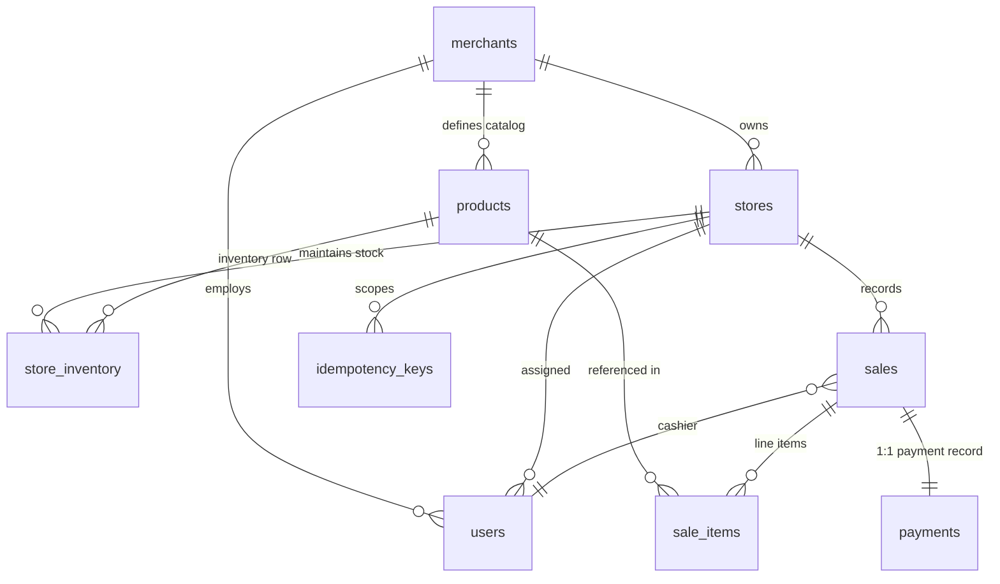

# Multi-Tenant POS Sales & Inventory Backend

A production-grade, multi-tenant Point of Sale (POS) backend service built with **NestJS**, **TypeScript**, **PostgreSQL**, and **Redis**. Designed for high-concurrency retail environments with strict tenant isolation, pessimistic row-level locking for inventory consistency, and transactional idempotency.

---

## Table of Contents

1. [Tech Stack & Architecture](#1-tech-stack--architecture)
2. [Quickstart & Setup](#2-quickstart--setup)
3. [Database & Schema Decisions](#3-database--schema-decisions)
4. [Multi-Tenant Isolation](#4-multi-tenant-isolation)
5. [Transaction & Concurrency Strategy](#5-transaction--concurrency-strategy)
6. [Idempotency Strategy](#6-idempotency-strategy)
7. [Payment Abstraction](#7-payment-abstraction)
8. [Redis Caching Implementation](#8-redis-caching-implementation)
9. [Running Tests](#9-running-tests)
10. [Postman Collection](#10-postman-collection)
11. [Trade-Offs, Assumptions & Future Scaling](#11-trade-offs-assumptions--future-scaling)

---

## 1. Tech Stack & Architecture

- **Framework**: NestJS 10 (TypeScript) — Modular Monolith architecture
- **Database**: PostgreSQL 16 with TypeORM (Repository Pattern + Unit of Work)
- **Cache**: Redis 7 via `@nestjs/cache-manager` & `ioredis` (Cache-Aside pattern)
- **Security**: Passport.js JWT, bcrypt password hashing, Role-Based Access Control (RBAC)
- **Validation & Transformation**: `class-validator`, `class-transformer`
- **Testing**: Jest + Supertest (Unit tests + Full E2E database suites)
- **Documentation**: OpenAPI / Swagger UI at `/api/docs`



---

## 2. Quickstart & Setup

### Prerequisites
- Node.js (v20+ recommended)
- Docker & Docker Compose

### 1. Clone & Enter Project Directory
```bash
cd pos-api
```

### 2. Configure Environment Variables
Copy `.env.example` to `.env`:
```bash
cp .env.example .env
```
*(The default settings connect out-of-the-box to the local Docker services).*

### 3. Spin Up Infrastructure (PostgreSQL 16 & Redis 7)
```bash
docker compose up -d
```
*Note: A Docker initialization script automatically provisions both `pos_db` (primary) and `pos_test` (dedicated test database).*

### 4. Install Dependencies
```bash
npm install
```

### 5. Run Database Migrations
```bash
npm run migration:run
```

### 6. Seed Sample Multi-Tenant Data
```bash
npm run seed
```

### 7. Start the API Server
```bash
# Development mode with hot-reload
npm run start:dev

# Or production build
npm run build && npm run start:prod
```
The server will start on `http://localhost:3000/api/v1`.  
Interactive Swagger documentation is available at `http://localhost:3000/api/docs`.

---

## 3. Database & Schema Decisions

### Entity Relationship Model



### Key Engineering Decisions:
1. **Catalog Scope (Merchant-Level vs Store-Level)**:
   - **Decision**: Products belong to the **Merchant** (`merchantId`), while `store_inventory` tracks the physical stock quantity per **Store** (`storeId`, `productId`).
   - **Rationale**: A retail business defines branding, SKUs, and standard product descriptions once per chain. Maintaining separate catalogs per store causes data drift and duplication. Each store independently stocks and tracks quantities in `store_inventory`.
2. **Financial Integrity (Minor Units)**:
   - All monetary values (`priceMinorUnits`, `totalMinorUnits`, `amountMinorUnits`) are stored as **`BIGINT` in minor units (e.g., paise/cents: ₹450.00 = 45000)**.
   - **Rationale**: Completely eliminates floating-point rounding errors (`0.1 + 0.2 !== 0.3`). Safe integer math in both PostgreSQL and TypeScript.
3. **Price Snapshotting**:
   - `sale_items.unit_price_snapshot` preserves the exact server-side price at the moment of sale. If merchant updates catalog prices later, historical financial and tax reports remain 100% immutable and accurate.
4. **Database Constraints as Defense-in-Depth**:
   - `CONSTRAINT "CHK_store_inventory_quantity" CHECK ("quantity" >= 0)` guarantees at the database storage engine level that stock can **never** become negative, even under hypothetical code anomalies.
   - `CONSTRAINT "UQ_products_merchantId_sku" UNIQUE ("merchantId", "sku")` ensures SKU uniqueness is scoped per merchant.
   - `CONSTRAINT "UQ_idempotency_keys_store_key" UNIQUE ("storeId", "key")` ensures idempotency keys are strictly scoped per store.

---

## 4. Multi-Tenant Isolation

### The Golden Rule
> **Tenant context is derived strictly from the cryptographically verified JWT (`req.user`) — NEVER trusted from query parameters, path variables, or request bodies.**

### Four Layers of Isolation:
1. **JWT Authentication Layer (`JwtAuthGuard`)**:
   - Every request extracts and verifies the bearer JWT token.
   - The token contains: `{ sub, merchantId, storeId, role }`.
2. **Role-Based Access Control (`RolesGuard`)**:
   - Strict role hierarchy: `OWNER (4) > ADMIN (3) > MANAGER (2) > CASHIER (1)`.
   - Cashiers cannot view stores list; managers cannot alter catalog prices.
3. **Cross-Tenant Guard (`StoreAccessGuard`)**:
   - Intercepts any route with `:storeId`. Verifies that the targeted store belongs to `req.user.merchantId`.
   - If store belongs to another merchant: immediately returns **`403 Forbidden`**.
   - If store does not exist at all: returns **`404 Not Found`**.
   - For `MANAGER` and `CASHIER`, ensures they can only operate on their specifically assigned store (`req.user.storeId === req.params.storeId`).
4. **Repository-Level Scoping**:
   - Every database query automatically appends `where: { merchantId: user.merchantId }`. Even if an attacker guesses a UUID of another merchant's product, the query returns `null` (**`404 Not Found`**), preventing any data leakage or even confirmation of item existence.

---

## 5. Transaction & Concurrency Strategy

### The Core Problem
```
Current Stock = 5
POS Terminal A attempts to sell 3 units.
POS Terminal B attempts to sell 3 units.
Without concurrency control: Both read 5 -> Both write (5 - 3 = 2) -> 6 sold, inventory oversold to -1!
```

### Concurrency Mechanisms Evaluated:
| Strategy | Pros | Cons | Verdict |
|---|---|---|---|
| **Pessimistic Locking (`SELECT FOR UPDATE`)** | Deterministic, zero client retries, strictly serializes row updates | Holds lock during transaction | **Chosen** |
| **Atomic Conditional UPDATE (`SET qty = qty - n WHERE qty >= n`)** | Fast for single item | Difficult to validate and roll back multi-item sales atomically | Rejected for multi-item POS |
| **Optimistic Locking (`version` column)** | Lock-free reads | High abort/retry storm on hot products under concurrent POS rush | Rejected for POS cashier UX |
| **SERIALIZABLE Isolation** | Database handles all conflicts | High retry rate; serializable abort errors (40001) | Overkill |

### Solution: Pessimistic Locking with Sorted Lock Acquisition
1. When `POST /sales` arrives, we sort all `productIds` in ascending lexicographical order before locking:
   ```typescript
   const sortedProductIds = [...productIds].sort();
   ```
   **Deadlock Prevention**: Sorting guarantees that concurrent transactions always acquire row locks in the exact same sequence (`Lock A -> Lock B`), mathematically eliminating circular wait deadlocks.
2. We query `store_inventory` using `setLock('pessimistic_write')` (`SELECT ... FOR UPDATE`):
   - Terminal A acquires the lock on the inventory row.
   - Terminal B attempts the same query and is put to wait by PostgreSQL.
   - Terminal A verifies `5 >= 3`, decrements stock from `5 -> 2`, commits, and releases lock.
   - Terminal B unblocks, reads the freshly committed stock (`2`), checks `2 >= 3` -> **FAILS validation**, and aborts with `422 Unprocessable Entity ("Insufficient inventory")`.
   - **Result**: Exactly one sale succeeds, stock becomes 2, overselling is impossible.

### Payment Call vs Database Transaction:
> **Never hold a database lock open across a slow external network call.**

1. **Step 1 (DB TX 1)**: In a fast (<5ms) database transaction, lock inventory, validate stock, calculate total, create `Sale (status: PENDING)`, and decrement inventory. Commit transaction immediately.
2. **Step 2 (Network I/O)**: Call `paymentPort.charge()` **outside** the database transaction. Database locks are not held while waiting on external payment gateways.
3. **Step 3 (Resolution)**:
   - **Payment SUCCESS**: Update `Sale` status to `PAID`, record payment record.
   - **Payment FAILED**: Run a **Compensation Transaction** that restores the decremented inventory (`qty = qty + n`), updates `Sale` to `FAILED`, and returns `402 Payment Required`.

---

## 6. Idempotency Strategy

POS terminals often face wireless drops. If a cashier clicks "Pay", the payment succeeds on the server, but the network drops before the POS receives the HTTP 201 response, the terminal automatically retries with the same `Idempotency-Key` header.

### Design:
- **Header**: `Idempotency-Key: <client-generated-uuid>` (Required on `POST /sales`).
- **Database Table**: `idempotency_keys` with `UNIQUE (storeId, key)`.
- **Request Fingerprinting**: Computes `SHA-256(method + path + sorted_body)`.
- **Flow**:
  1. **New Request**: Interceptor inserts key with `isProcessing: true`. Proceeds to handler.
  2. **Success**: Saves response payload (`statusCode`, `responseBody`) and marks `isProcessing: false`.
  3. **Identical Retry**: Detects existing completed key with identical request hash -> Returns stored response directly with `X-Idempotency-Replayed: true` without hitting database transaction or charging payment again.
  4. **In-Flight Duplicate**: If another request arrives while the first is still processing -> Returns `409 Conflict ("A request with this key is already being processed")`.
  5. **Payload Mismatch**: If same key is used with a different cart payload -> Returns `422 Unprocessable Entity ("Idempotency-Key reused with a different request payload")`.
  6. **Automatic Cleanup**: A scheduled cron job (`@Cron('0 2 * * *')`) purges keys older than 24 hours.

---

## 7. Payment Abstraction

Implemented using the **Port / Adapter (Strategy)** pattern:
- **Port**: `PaymentPort` interface with `charge(request: ChargeRequest): Promise<ChargeResult>`.
- **Token**: `PAYMENT_PORT` symbol used for dependency injection.
- **Adapter**: `MockPaymentProvider` implements `PaymentPort`.
- **Deterministic Testing**:
  - `metadata.simulateFailure: true` forces a deterministic decline.
  - Environment variable `MOCK_PAYMENT_FAIL_RATE` allows probabilistic chaos testing.
- **Provider Swap**: To replace the mock with Razorpay or Stripe, simply create `RazorpayProvider implements PaymentPort` and update `payments.module.ts`. Zero changes required in `SalesService`.

---

## 8. Redis Caching Implementation

### Why Redis Caching Was Chosen (vs Async Queue):
The POS is an interactive, read-heavy transactional application. Cashiers constantly search and browse product catalogs and check inventory display before every sale. Caching these read-heavy operations provides immediate latency improvements (<2ms response times) and protects the primary PostgreSQL database from read saturation during store rush hours.

### Cache Strategy (Cache-Aside):
1. **Product Catalog**:
   - Key: `products:merchant:{merchantId}` & `product:{merchantId}:{productId}`
   - TTL: 300 seconds (5 minutes)
   - Invalidation: Immediately purged on `POST`, `PATCH`, or `DELETE` on products.
2. **Store Inventory Display**:
   - Key: `inventory:store:{storeId}:product:{productId}`
   - TTL: 30 seconds
   - Invalidation: Immediately purged on `PUT /inventory` updates.
   - *Note: While display reads use the cache, sale creation always performs an authoritative check directly against PostgreSQL with `SELECT ... FOR UPDATE` to guarantee absolute data consistency.*
3. **Store Access Permission**:
   - Key: `store_access:{merchantId}:{storeId}`
   - TTL: 60 seconds

---

## 9. Running Tests

The test suite covers all four mandatory business scenarios specified in the assignment, plus the bonus concurrency test and unit tests.

### Run Unit & Bonus Concurrency Tests:
```bash
npm test
```
Tests:
- `sales.service.spec.ts`: Unit tests verifying pricing math, validation errors, and payment compensation.
- `sales.service.concurrent.spec.ts`: **Bonus Concurrency Test** simulating 2 POS terminals competing for the same 5 units of stock simultaneously (`Promise.allSettled`). Verifies that exactly one succeeds, stock becomes 2, and overselling is prevented.

### Run Full E2E Tests:
```bash
npm run test:e2e
```
Coverage:
- **T-1 (Successful Sale)**: Full flow with inventory deduction, payment SUCCESS, and PAID status.
- **T-2 (Failed Sale)**: Payment decline simulation, FAILED status, and compensation transaction restoring inventory.
- **T-3 (Insufficient Inventory)**: Requesting quantity > available stock returns 422 before payment.
- **T-4 (Tenant Isolation)**: Cross-tenant product lookups return 404; cross-merchant store requests return 403.
- **T-5 (Idempotency)**: Retrying a sale with the same key returns the cached response without double-selling or creating a second sale.

---

## 10. Postman Collection

Pre-configured Postman collection and environment files are located in `pos-api/postman/`:
- `pos-api.postman_collection.json`
- `pos-api.postman_environment.json`

### Pre-Seeded Test Credentials:
| Role | Email | Password | Scope |
|---|---|---|---|
| **Owner A** | `owner-a@merchant.com` | `password123` | Merchant Alpha (all stores) |
| **Manager S1** | `manager-s1@merchant.com` | `password123` | Store 1 (Alpha Downtown) |
| **Cashier S1** | `cashier-s1@merchant.com` | `password123` | Store 1 (Stock = 5 for Espresso) |
| **Cashier S3** | `cashier-s3@merchant.com` | `password123` | Store 3 (Merchant Beta) |

---

## 11. Trade-Offs, Assumptions & Future Scaling

### Trade-Offs Made:
1. **Pessimistic Locking vs High Write Concurrency**:
   - *Trade-off*: Locking inventory rows causes concurrent checkouts for the *exact same product* in the *same store* to serialize.
   - *Defense*: In retail POS, multiple cashiers rarely scan the exact same physical last item at the exact millisecond. Financial accuracy and zero overselling take priority over unconstrained write concurrency.
2. **Compensating Transaction vs Two-Phase Commit**:
   - *Trade-off*: Decrementing inventory before calling payment requires compensation if payment fails.
   - *Defense*: 2PC across third-party HTTP gateways is impossible. Decrementing stock first ensures we never charge a customer for an out-of-stock item.
3. **PostgreSQL vs Redis for Idempotency Keys**:
   - *Trade-off*: Using PostgreSQL for idempotency keys adds storage in the primary database.
   - *Defense*: Financial durability is paramount. Storing idempotency records in PostgreSQL guarantees ACID durability across server or Redis restarts.

### Documented Future Scaling Path:
- **Read Replicas**: Direct all cached list endpoints (`GET /products`, `GET /sales`) to PostgreSQL read replicas using TypeORM replication configuration.
- **Async Queue (BullMQ)**: Offload non-critical post-sale tasks (emailing PDF tax receipts, updating CRM loyalty points, nightly sales aggregations) to background workers.
- **Table Partitioning**: Partition the `sales` and `sale_items` tables by `createdAt` (monthly ranges) or `storeId` hash once table size exceeds 10M rows.
- **Connection Pooling**: Deploy PgBouncer in front of PostgreSQL to handle thousands of concurrent POS terminal WebSocket/HTTP connections.
